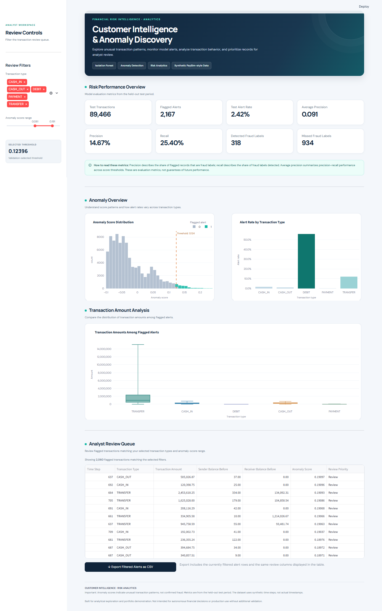
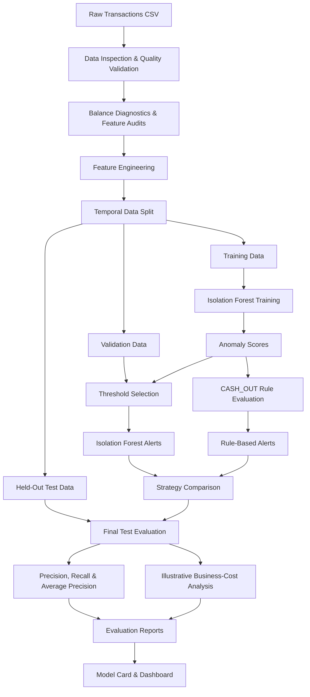

# Customer Intelligence & Anomaly Platform

### Transaction Risk Analytics with Unsupervised Anomaly Detection

A data science portfolio project that investigates suspicious financial transactions by combining **Isolation Forest anomaly detection**, a **rule-based fraud detector**, temporal model evaluation, and business-cost analysis.

The goal is to help analysts prioritize suspicious transactions for investigation while understanding the trade-offs between fraud detection, false-positive alerts, and estimated investigation costs.

<p align="center">

  
  
  
  
  

</p>

> **Project status:** Experimental portfolio project. Evaluated on a held-out temporal test set using simulated transaction data. Not approved for production financial decisions.


---

## Table of Contents

- [Business Problem](#-business-problem)
- [Key Results](#-key-results)
- [Project Features](#-project-features)
- [System Architecture](#-system-architecture)
- [Machine Learning Approach](#-machine-learning-approach)
- [Business-Cost Analysis](#-business-cost-analysis)
- [Technology Stack](#-technology-stack)
- [Repository Structure](#-repository-structure)
- [Getting Started](#-getting-started)
- [Reproducing the Evaluation](#-reproducing-the-evaluation)
- [Model Documentation](#-model-documentation)
- [Limitations and Responsible Use](#-limitations-and-responsible-use)
- [Future Improvements](#-future-improvements)

## 🎯 Business Problem

Financial transaction systems process large volumes of payments and transfers. Reviewing every transaction manually is difficult, while an overly aggressive detection system can overwhelm analysts with false-positive alerts.

This project explores three practical questions:

1. Can an unsupervised model identify unusual transaction behavior?
2. Can a targeted business rule detect suspicious transactions that the anomaly detector misses?
3. Does combining both strategies improve fraud recall and estimated business cost?

The solution compares an Isolation Forest model, a CASH_OUT rule, and combined alert strategies using a time-based evaluation design.

## 📊 Key Results

The final evaluation uses a held-out test period covering steps 632–743.

| Test metric | Result |
|---|---:|
| Transactions evaluated | 89,466 |
| Fraud cases | 1,252 |
| Isolation Forest average precision | 0.091017 |
| Combined OR alerts | 2,574 |
| Combined OR true positives | 725 |
| Combined OR recall | 57.91% |
| Combined OR precision | 28.17% |
| Combined OR estimated cost | $88,295 |

### Strategy comparison

| Strategy | Alerts | True positives | False positives | False negatives | Precision | Recall | Estimated cost |
|---|---:|---:|---:|---:|---:|---:|---:|
| Isolation Forest | 2,167 | 318 | 1,849 | 934 | 14.67% | 25.40% | $149,345 |
| CASH_OUT rule | 407 | 407 | 0 | 845 | 100.00% | 32.51% | $126,750 |
| Combined OR | 2,574 | 725 | 1,849 | 527 | 28.17% | 57.91% | $88,295 |
| Combined AND | 0 | 0 | 0 | 1,252 | 0.00% | 0.00% | $187,800 |

**Key finding:** On this test period, the Combined OR strategy detected 725 of 1,252 fraud cases. It achieved higher recall than either individual strategy and had the lowest estimated cost among the evaluated approaches.

Under the project's illustrative cost assumptions, its estimated cost was $61,050 lower than the Isolation Forest strategy alone.

These results describe this particular held-out sample. They do not guarantee future performance or demonstrate production readiness.

## ✨ Project Features

- **Data quality assessment:** inspect transaction data and validate data-quality rules.
- **Feature engineering:** transform amounts and balances into model-ready features.
- **Anomaly detection:** train an unsupervised Isolation Forest model.
- **Rule-based detection:** evaluate a targeted CASH_OUT transaction rule.
- **Threshold selection:** select the anomaly threshold using validation data.
- **Temporal evaluation:** evaluate performance on a later, held-out period.
- **Strategy comparison:** compare model-only, rule-only, OR, and AND strategies.
- **Cost-sensitive analysis:** estimate the impact of false positives and missed fraud.
- **Model documentation:** record methodology, results, assumptions, and limitations.
- **Dashboard interface:** provide a dashboard entry point in `dashboard/app.py`.

## 🏗️ System Architecture

The following diagram describes the project's analytical workflow.



### Architecture layers

| Layer | Responsibility | Main location |
|---|---|---|
| Data validation | Inspect inputs and validate transaction data | `src/data/` |
| Analytics | Investigate balance patterns and anomaly features | `src/analytics/` |
| Feature engineering | Build transaction and customer features | `src/features/` |
| Model training | Fit the unsupervised anomaly detector | `src/risk/train_isolation_forest.py` |
| Risk evaluation | Select thresholds and compare alert strategies | `src/risk/` |
| Reporting | Store evaluation results and model documentation | `reports/` |
| Dashboard | Dashboard application entry point | `dashboard/app.py` |
| Testing | Automated validation-rule tests | `tests/` |

## 🧠 Machine Learning Approach

### 1. Dataset and temporal split

The project uses a PaySim-style simulated transaction dataset containing approximately 6.36 million records.

| Split | Step range | Purpose |
|---|---|---|
| Training | 1–520 | Fit the anomaly detector |
| Validation | 521–631 | Select the threshold and compare strategies |
| Test | 632–743 | Final held-out evaluation |

This split preserves chronological order instead of randomly mixing earlier and later transactions.

### 2. Feature engineering

The Isolation Forest uses 11 features:

- Log transaction amount
- Log sender balance
- Log recipient balance
- Sender balance is zero
- Recipient balance is zero
- Transaction amount-to-sender-balance ratio
- Transaction-type indicators for CASH_IN, CASH_OUT, DEBIT, PAYMENT, and TRANSFER

The model is fitted on a deterministic sample of 200,000 training transactions without using fraud labels during fitting.

### 3. Isolation Forest

Isolation Forest is an unsupervised anomaly detection algorithm. It learns patterns that help distinguish unusual observations from the broader data distribution.

The transformed anomaly score is:

`anomaly_score = -model.decision_function(X)`

A higher score indicates a more unusual transaction.

The selected threshold is `0.1239624561`, determined using validation data with a target alert budget of approximately 2%. The threshold is frozen for final test evaluation.

### 4. Rule-based detector

The CASH_OUT rule flags a transaction when all three conditions hold:

1. Transaction type is `CASH_OUT`.
2. Transaction amount exceeds `$200,000`.
3. The sender's old balance approximately equals the transaction amount, using an absolute tolerance of `$0.01`.

This rule is evaluated independently of the anomaly model.

### 5. Combined strategies

- **Isolation Forest:** flag transactions exceeding the selected anomaly threshold.
- **CASH_OUT rule:** flag transactions satisfying the business rule.
- **Combined OR:** flag a transaction if either strategy flags it.
- **Combined AND:** flag a transaction only if both strategies flag it.

On the held-out test set, the two individual strategies had zero overlapping alerts. The OR strategy therefore increased the number of flagged transactions and detected more fraud cases.

## 💰 Business-Cost Analysis

The experiment uses the following illustrative assumptions:

| Cost component | Assumption |
|---|---:|
| False-positive investigation | $5 per alert |
| Missed fraud | $150 per missed case |

Estimated total cost is calculated as:

`Total cost = (false positives × $5) + (false negatives × $150)`

This calculation treats every missed fraud case as having the same assumed cost. It does not calculate the actual monetary loss of each transaction.

### Why the comparison matters

A detection model should not be judged by recall alone. A model that catches more fraud can also generate more alerts and consume more investigation resources.

The Combined OR strategy produced the lowest estimated cost among these four strategies under the assumptions above. Before using such a strategy in a real financial institution, the costs, investigation capacity, alert handling, and operational requirements would need to be validated with business stakeholders.

## 🛠️ Technology Stack

| Technology | Purpose |
|---|---|
| Python | Data processing and model development |
| pandas / NumPy | Data manipulation and numerical operations |
| scikit-learn | Isolation Forest and evaluation metrics |
| Streamlit | Dashboard application |
| pytest | Automated tests |
| Git / GitHub | Version control and project presentation |

See `requirements.txt` for the project's dependency list.

## 📁 Repository Structure

```text
customer-intelligence-anomaly-platform/
├── configs/                  # Project configuration
├── dashboard/
│   └── app.py                 # Dashboard entry point
├── data/
│   ├── raw/                   # Local raw dataset (not committed)
│   ├── processed/             # Generated processed data
│   └── features/              # Generated features and model artifacts
├── notebooks/                 # Exploratory notebooks
├── reports/
│   ├── model_card.md
│   ├── threshold_analysis.json
│   ├── validation_business_cost.json
│   ├── final_test_business_cost.json
│   └── data_quality_report.json
├── src/
│   ├── analytics/             # Anomaly and balance investigations
│   ├── data/                  # Inspection and validation
│   ├── features/              # Feature engineering
│   ├── risk/                  # Training and risk evaluation
│   └── utils/                 # Shared utilities
├── tests/
│   └── test_validation_rules.py
├── .gitignore
├── requirements.txt
└── README.md
```

Generated CSV reports, local datasets, and model artifacts may be excluded from Git by `.gitignore`. The committed JSON reports preserve selected analysis outputs.

## 🚀 Getting Started

### Prerequisites

- Python installed
- Git installed
- A local copy of the authorized dataset
- Windows PowerShell or a compatible terminal

### 1. Clone the repository

Replace the placeholder with your actual GitHub repository URL.

```powershell
git clone <YOUR-REPOSITORY-URL>
cd customer-intelligence-anomaly-platform
```

### 2. Create a virtual environment

```powershell
python -m venv .venv
.\.venv\Scripts\Activate.ps1
```

### 3. Install dependencies

```powershell
python -m pip install --upgrade pip
pip install -r requirements.txt
```

### 4. Add the dataset

Place the authorized dataset at:

```text
data/raw/transactions.csv
```

The raw dataset is intentionally excluded from version control. Dataset access and usage must follow the source's terms.

### 5. Run automated tests

```powershell
pytest -q
```

The initial project test run completed successfully with **5 tests passed**. Run the tests again after making changes to verify the current state of your checkout.

### 6. Launch the dashboard

If `dashboard/app.py` is configured as a Streamlit app and its required input artifacts are available:

```powershell
streamlit run dashboard/app.py
```

The dashboard may require previously generated reports or feature artifacts. Follow the input requirements in the application before launching it in a fresh environment.

## 🔁 Reproducing the Evaluation

Important scripts include:

| Script | Purpose |
|---|---|
| `src/data/inspect_data.py` | Inspect the input data |
| `src/data/validate_data.py` | Validate data quality |
| `src/features/build_transaction_features.py` | Build transaction features |
| `src/features/build_customer_features.py` | Build customer features |
| `src/risk/train_isolation_forest.py` | Train the anomaly detector |
| `src/risk/evaluate_alert_thresholds.py` | Analyze candidate alert thresholds |
| `src/risk/evaluate_validation_business_cost.py` | Evaluate strategies on validation data |
| `src/risk/evaluate_final_test.py` | Evaluate the frozen strategy on test data |

Run scripts from the repository root. Inspect each script's input paths and expected artifacts before executing it. The full workflow may require generating intermediate files before training or evaluation.

**Evaluation discipline:** use training data for model fitting, validation data for threshold and strategy selection, and the test set only for final evaluation. Do not retune the threshold against test labels.

## 📄 Model Documentation

See [`reports/model_card.md`](reports/model_card.md) for details about:

- Intended use
- Data split and feature design
- Model configuration
- Held-out test performance
- Illustrative cost assumptions
- Limitations and risks

## ⚠️ Limitations and Responsible Use

- The dataset is simulated; results may not generalize to live financial transactions.
- Anomaly scores identify unusual behavior, not confirmed fraud.
- A rule's observed precision on one test period is not a guarantee of future precision.
- The assumed false-positive and missed-fraud costs are not verified industry figures.
- Fraud patterns, transaction distributions, and fraud prevalence can change over time.
- The model has not been established as production-ready.
- Deployment would require further testing, monitoring, security review, operational controls, and validation against real business requirements.

This project is for portfolio demonstration and analytical experimentation. It should not be used to automatically block real customer transactions or make consequential customer decisions without further validation and appropriate human oversight.

## 🔭 Future Improvements

- Add automated tests for feature engineering and risk evaluation.
- Add a reproducible end-to-end pipeline with explicit artifact dependencies.
- Add model monitoring and data-drift checks.
- Evaluate alert quality across additional temporal periods.
- Validate cost assumptions with realistic investigation and loss scenarios.
- Add dashboard screenshots and a documented dashboard walkthrough.
- Set up continuous integration to run tests on every pull request.

## 👨‍💻 Author

**Rauof Qadir**
Software Engineer | Data Science & Financial Risk Analytics

This project demonstrates practical work in feature engineering, unsupervised learning, temporal validation, fraud-risk analysis, and business-oriented model evaluation.
